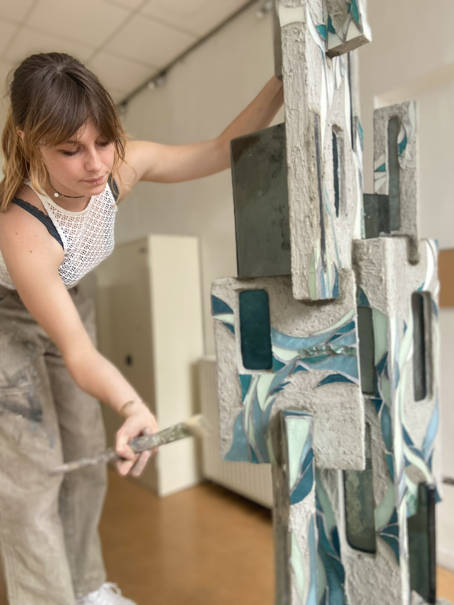
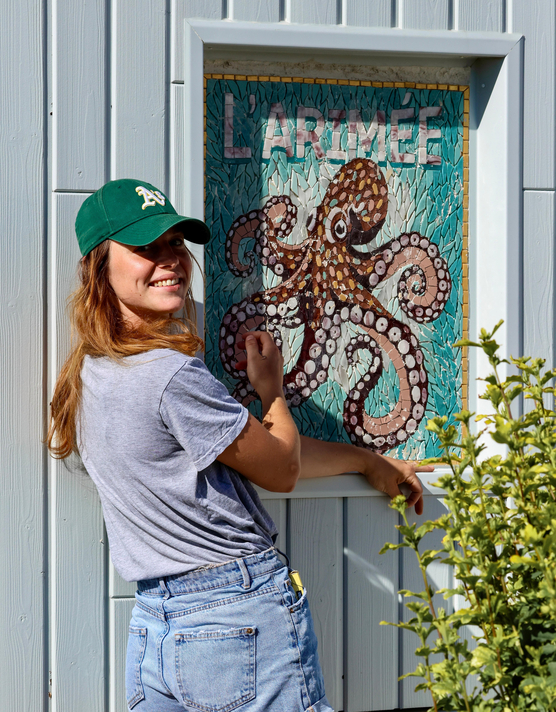
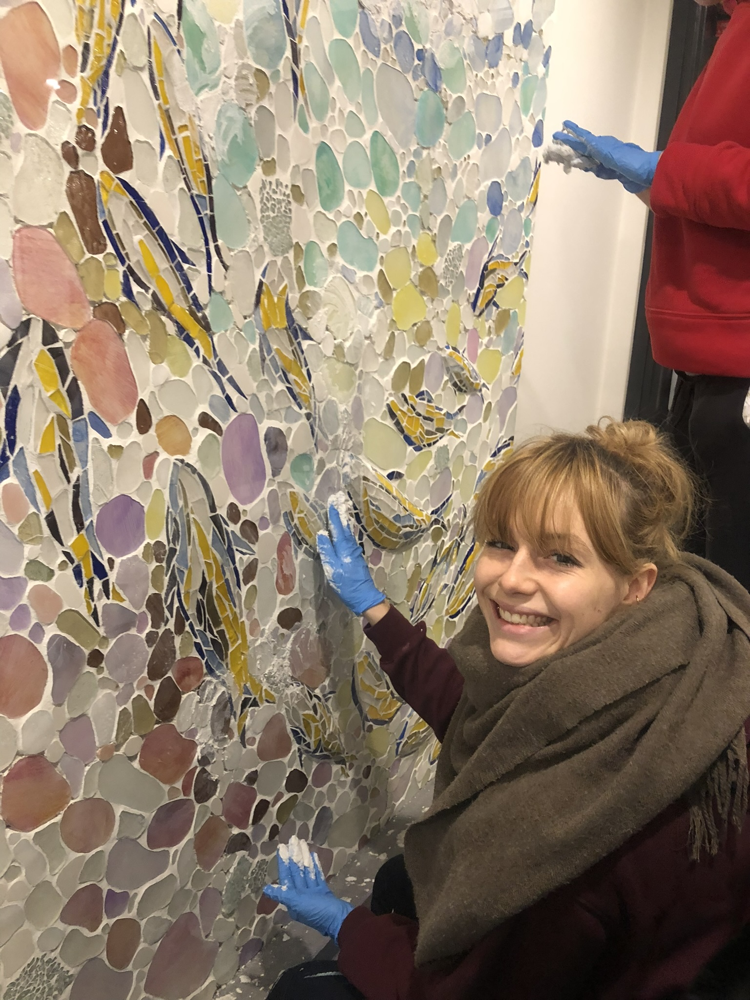

Je me présente, je m'appelle Yaëlle Lohé. Je suis artiste/artisan mosaïste diplômée en mosaïque ornementale à l'Ecole Nationale Supérieure des Arts Appliqués et des Métiers d'Arts à Paris.

Le beau nourrit l'esprit et donne vie aux rêves. Vivons dans le monde que nous souhaitons voir. Entre légende et réalité, il suffit de franchir la porte.

Je vous accompagne dans la création de réalisations uniques et personnalisées. La mosaïque est un médium d'une grande liberté, qui permet de donner vie à des projets sur mesure, qu'ils soient décoratifs, artistiques ou fonctionnels.

Chaque création est pensée en fonction de vos envies et de votre univers. Pour moi, chaque nouveau projet est une rencontre, un défi créatif et une aventure à construire ensemble.

N'hésitez pas à me contacter par téléphone ou par e-mail pour échanger sur votre projet.

En parallèle des commandes sur mesure, je crée des œuvres inspirées par les thèmes qui m'animent profondément. Elles sont le reflet de mon imaginaire, de mes émotions et de ma sensibilité.

Au-delà du folklore, l’histoire et le climat de la Bretagne nous offrent un potentiel esthétique inouï. Ses pierres ont une histoire à raconter et ses légendes continuent de fasciner et d'inspirer.

De ses racines celtes, elle conserve une profonde connexion à la pierre. Depuis des siècles, mysticisme et réalité continuent de s'y côtoyer et de s'y entremêler singulièrement.

Inspiré par le climat, le ciel et la pierre de Bretagne, autant que par les légendes qui résonnent avec son âme celte, ma démarche artistique de mosaïste explore les liens qui me rattachent à cette région. En mêlant tradition et contemporanéité, je cherche à capturer l’essence de son histoire en y apportant un regard contemporain.

Ce qui m'intéresse c'est de travailler sur la notion de « passage » : je veux étudier la façon de donner un intérêt au passage entre deux lieux tout en jouant avec le lien entre croyances et réalité. Partir du réel pour accompagner l'observateur vers une autre approche sur ce qui l'entoure, une vérité au-delà de celle disponible à la surface de la vie quotidienne.

Ses légendes ouvrent la porte sur un monde imaginaire et suggère un passage. Beaucoup d'autres éléments relatifs à la Bretagne se rejoignent sur cette notion de lien entre deux univers : les menhirs symbolisent une connexion avec l'au-delà, les symboles celtes sont un langage, ils expriment une façon particulière d'appréhender la vie humaine. Et ce toujours en étant liée à cette idée de connexion entre plusieurs mondes.
